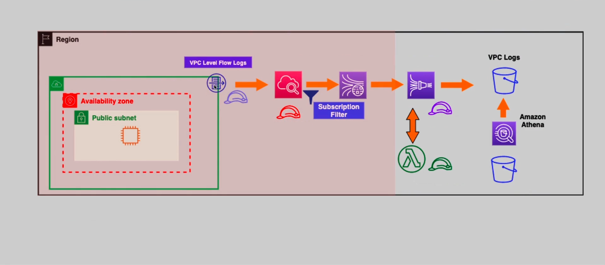

# AWS VPC Flow Logs & Athena Security Analytics

## 📌 Overview
A comprehensive security and monitoring project that captures VPC Flow Logs, streams them through Kinesis, and uses AWS Lambda to transform the data before storing it in Amazon S3. Finally, Amazon Athena is used to query the logs for security insights, such as identifying malicious IPs and repeated rejected connections.

## 🏗️ Architecture Diagram


## 🎯 Requirements Covered
1. **Data Ingestion:** Capturing VPC Flow Logs and sending them to CloudWatch Logs.
2. **Data Streaming:** Using CloudWatch Subscription Filters to stream logs to Amazon Kinesis Data Streams (KDS).
3. **Data Transformation:** Using Amazon Data Firehose with an AWS Lambda function to decompress and format the data (Base64 to JSON/Text).
4. **Data Storage:** Storing the processed logs in an Amazon S3 Source Bucket.
5. **Security Analytics (Athena):** Creating an external table in Athena to query the logs and identify:
   - IP addresses with repeated rejected connections (e.g., port scanning or DDoS attempts).
   - Excessive SSH login attempts (if applicable).
   - General network traffic patterns.

## 🔧 AWS Services Used
| Service | Purpose |
|---------|---------|
| Amazon VPC | Network isolation and Flow Logs generation |
| Amazon EC2 | Web server generating network traffic |
| Amazon CloudWatch | Log group for Flow Logs & Subscription Filter |
| Amazon Kinesis Data Streams | Real-time data streaming |
| Amazon Data Firehose | Data delivery to S3 with Lambda transformation |
| AWS Lambda | Decompressing and formatting logs |
| Amazon S3 (Source & Dest) | Storing raw logs and Athena query results |
| AWS IAM | Roles for VPC, CloudWatch, Firehose, and Lambda |
| Amazon Athena | Serverless SQL query service for log analysis |

## 📂 Repository Structure
```text
.
├── architecture/          # Architecture diagrams
├── screenshots/           # AWS Console screenshots
├── documentation/         # Requirements & design decisions
├── testing/               # Connectivity & validation tests
└── infrastructure-as-code/ # (Planned) Terraform implementation
```
🛠️ Implementation Summary
Manual Provisioning: All resources were manually provisioned via the AWS Management Console.

Data Pipeline: Validated end-to-end flow (Flow Logs -> CloudWatch -> KDS -> Firehose -> Lambda -> S3).

Security Analytics: Successfully queried Athena to identify IP addresses that were repeatedly rejected (REJECT) by the Security Group, simulating a real-world security analysis.

📸 Screenshots
All implementation screenshots are available in the screenshots/ folder.

📘 Lessons Learned
Data Ingestion Pipelines: Learned how to build a complete data streaming pipeline using Kinesis and Firehose.

Lambda Transformation: Understood the importance of transforming data (Base64/Gzip) before storing it for analytics.

Athena for Security: Discovered how powerful Athena is for querying network logs to detect anomalies and threats.

🚀 Future Enhancements
Infrastructure as Code: Automate the entire infrastructure using Terraform.

Automated Alerts: Integrate Amazon QuickSight or CloudWatch Alarms to alert on suspicious IPs found in Athena.

Integration with WAF: Automatically block the malicious IPs detected by Athena using AWS WAF.

📄 License
This project is licensed under the MIT License - see the LICENSE file.

👤 Author
Mohammed Albayati

GitHub: @MohammedAlbayati1983
